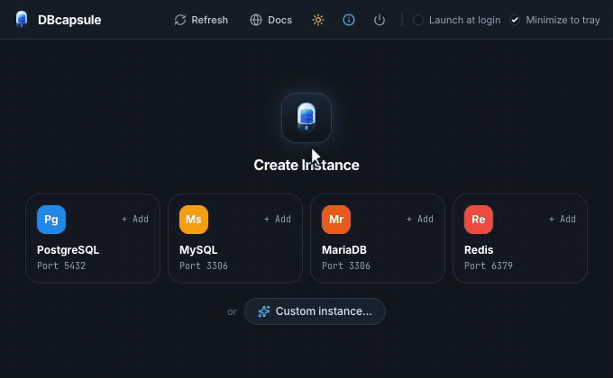

# DBcapsule

**The effortless way to run local databases without Docker.**

Run PostgreSQL, MySQL, MariaDB, and Redis side by side on isolated ports with zero configuration.

[**Website**](https://dbcapsule.com) • [**Download Releases**](https://github.com/AptodevLTD/dbcapsule/releases) • [**Report an Issue**](https://github.com/AptodevLTD/dbcapsule/issues)

 

---

## ⚡️ Why DBcapsule?

Docker desktop is heavy, consumes gigabytes of RAM, and drains laptop batteries. Setting up native database daemons manually often leads to permission conflicts, messy configuration files, and port collisions.

**DBcapsule** gives you the best of both worlds:
- **Zero Configuration**: 1-click Quick Add for PostgreSQL, MySQL, MariaDB, and Redis.
- **Isolated Ports**: Automatically detects port availability and assigns safe ports with zero conflicts (`EADDRINUSE`).
- **Multiple Versions Side by Side**: Run multiple versions simultaneously without collision.
- **Ultra Lightweight**: Runs as optimized, isolated host processes with near-zero memory footprint when idle.
- **Developer First**: Instant copyable connection strings and URI snippets for Node.js, Python, Go, PHP, and ORMs.
- **Works with Any Client**: Connect instantly via TablePlus, DBeaver, Prisma Studio, DataGrip, Beekeeper, or terminal CLI.

---

## 🚀 Downloads & Installation

Pre-compiled, signed packages are available on our [**Releases Page**](https://github.com/AptodevLTD/dbcapsule/releases):

### 🍏 macOS (11.0+)
- **Apple Silicon (M1/M2/M3/M4)**: Download [`DBcapsule-0.2.1-beta-arm64.dmg`](https://github.com/AptodevLTD/dbcapsule/releases/latest)
- **Intel (x86_64)**: Download [`DBcapsule-0.2.1-beta-amd64.dmg`](https://github.com/AptodevLTD/dbcapsule/releases/latest)

*Installation:* Open the `.dmg` and drag **DBcapsule** into your `/Applications` folder.

### 🪟 Windows (10 / 11 64-bit)
- **Setup Installer**: Download [`dbcapsule-0.2.1-beta-amd64-installer.exe`](https://github.com/AptodevLTD/dbcapsule/releases/latest)

*Installation:* Run the installer and follow the guided setup wizard.

---

## 🗄️ Supported Database Engines

- **PostgreSQL**
- **MySQL**
- **MariaDB**
- **Redis**

---

## 🐛 Bug Reports & Feature Requests

This repository is dedicated to **public releases, issue tracking, and community feedback**.

- **Found a bug?** Please [open an issue](https://github.com/AptodevLTD/dbcapsule/issues/new) with your OS version, database engine, and log output.
- **Have a feature idea?** Submit a [feature request](https://github.com/AptodevLTD/dbcapsule/issues/new).
- **Security issues:** Please report security concerns privately to [security@dbcapsule.com](mailto:security@dbcapsule.com).

---

## 🔒 Privacy & Terms

- [Privacy Policy](https://dbcapsule.com/privacy-policy)
- [Terms of Service](https://dbcapsule.com/terms)

DBcapsule operates strictly on your local machine. No database credentials, queries, or database payloads ever leave your device.

---

Crafted with care by **[aptodev.](https://github.com/AptodevLTD)**

Copyright © 2026 Aptodev. All rights reserved.

